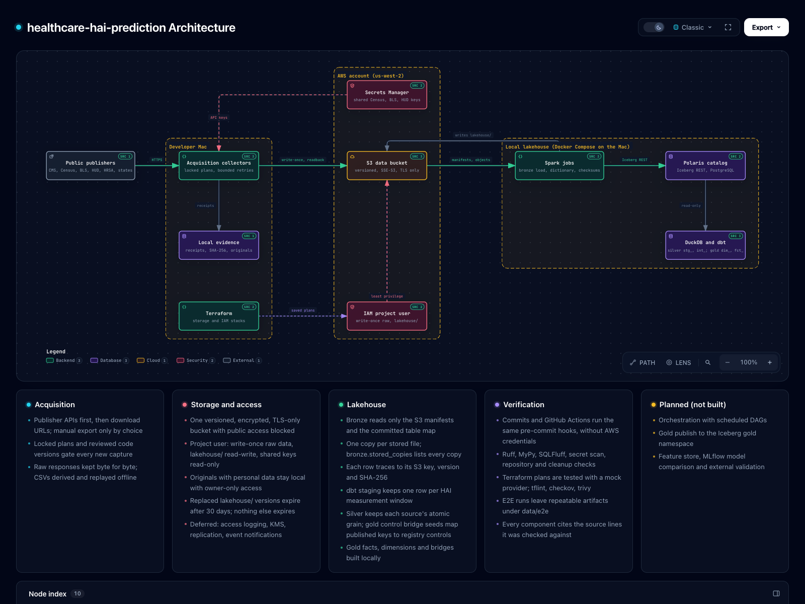

# healthcare-hai-prediction

Predicts hospital healthcare-associated infection rates from public CMS, Census, BLS and state data on AWS.

Hospital-acquired infection prediction research for a data engineer, built as a reproducible data engineering project.
This fresh repository builds on the capstone concept, not its implementation. Same-period
prediction is primary: a hospital's infection score for a window is predicted from
measures whose measured period ends before that window starts. Forecasting later windows is a later extension. Acquisition and S3
storage precede comprehensive schema review and tutorial drafting. Availability
does not establish clinical validity or model eligibility.

## Table of Contents

- [Security](#security)
- [Background](#background)
- [Install](#install)
- [Usage](#usage)
- [Architecture](#architecture)
- [Data](#data)
- [Quality Checks](#quality-checks)
- [Deploy and Teardown](#deploy-and-teardown)
- [Repository Layout](#repository-layout)
- [Limitations](#limitations)
- [Contributing](#contributing)
- [License](#license)

## Security

Deployment configuration is Internal; credentials are Restricted and never
belong in tracked files. Settings come only from the ignored `.env`, described
by `.env.example`. API keys live in AWS Secrets Manager and are read only at run
time (see [Install](#install)). Every commit is scanned for secrets, credential
files and data files (see [Quality Checks](#quality-checks)). Report a suspected
secret or personal value in this repository to the repository owner privately.

## Background

The project asks whether a hospital's infection score can be predicted from
public measures known as of the window start and why a simpler earlier model explained little
of the variation. Collection is complete and its code is in this repository;
acquisition closeout is pending the final publisher redownload (run 3)
and confirmed disposal of personal originals. Public sources are collected
through publisher APIs first, then download URLs, into private versioned S3
storage with a receipt, hash and version readback for every object. The bronze
layer of a local Apache Iceberg lakehouse then holds one copy of each data file that
the committed table map selects, as published, with each row traced to its S3 object version and checksum. It
also lists every other stored copy. All 330 mapped tables are loaded and checked; a
table whose files were all removed for privacy left the map. A dbt staging layer in DuckDB
reads the HAI, cost report, IPPS, occupational-mix, Provider of Services, Hospital General
Information, ownership, Medicare inpatient, HHS hospital capacity, ONC Promoting Interoperability and Care Compare
process and patient-experience tables. It keeps one row
per HAI and Care Compare measurement window, one row per hospital cost report, one Provider of
Services row per hospital and snapshot and one case-mix index per hospital and payment-rule year.
A hospital-year spine, which lines each hospital and calendar-year HAI window up with the Provider of
Services snapshot and the case-mix index from before the window and flags the model population, is saved in
`features/` for the feature phase. Under the layer design approved on October 10 2026, silver does only the standard
cleansing steps at each source's atomic grain and is not stored. Gold holds the atomic facts, conformed dimensions and
bridges in `dbt/models/gold/`, built and checked locally; publishing them to the Iceberg `gold` namespace is a later
stage. The gold control bridge seeds map each published key to its registry control. The hospital-window spine and the as-of
alignment are computed in the feature phase. Modeling and serving come later. The [Architecture](#architecture)
diagram shows what is built and what is planned.

## Install

Prerequisites: macOS on Apple silicon or Linux AMD64, Python 3.12, Git,
Terraform 1.16.1 and AWS CLI v2. Node.js 18 or later and Google Chrome render the
architecture diagram. The lakehouse runs in Docker Desktop; the launcher (`orchestration/launcher.py`) computes a
memory plan for every job from what Docker and the Mac have free and stops a launch whose container budget is below
4 GiB. Native quality tools install into the ignored `.tools/` at versions and publisher SHA-256 values pinned in
`config/quality_tools.json`.

```sh
python3.12 -m venv .venv
.venv/bin/python -m pip install -r requirements.txt
.venv/bin/python scripts/quality/install_tools.py
.venv/bin/python -m scripts.quality.install_markdownlint
.venv/bin/python -m scripts.quality.install_sqlfluff
.venv/bin/python -m scripts.lakehouse.dbt_package_archive fetch
PRE_COMMIT_HOME="$PWD/.tools/pre_commit_cache" .venv/bin/python -m pre_commit install
cp .env.example .env
```

Fill every value in `.env`; the file stays out of Git. `AWS_PROFILE` is the
project profile, named `<PROJECT_NAME>_<ENVIRONMENT>` after its same-named IAM
user. IAM changes use a separate administrator profile that is never stored in
`.env`.

The services are defined in `docker-compose.yaml`, which the launcher reads as its service model; the launcher, not
Compose, starts every container:

- PostgreSQL and Apache Polaris 1.8.0 use digest-pinned images.
- The Spark 4.1.2 (Iceberg 1.11.0), DuckDB 1.5.6 analytics, Great Expectations quality and Polaris bootstrap images are
  built from `services/`, with their Python packages hash-pinned; each job image carries the deadline entrypoint.

The launcher uses local images only and never pulls or builds one. Before the first catalog command, pull the two pinned
images and build the others once:

```sh
docker pull postgres:17@sha256:d74eeac9a635390a49bc21bd49fccd973de707e2a53a76ac49b552b8712ec46f
docker pull apache/polaris:1.8.0@sha256:347615e736cab2c9be0d8c464552ac930be4755302bb0aeb745216bbae99ba5b
docker build -t hai-polaris-admin:1.8.0 --build-context hai=./services/hai services/lakehouse/polaris_admin
docker build -t hai-lakehouse-spark:4.1.2-iceberg1.11.0 --build-context hai=./services/hai services/lakehouse/spark
docker build -t hai-analytics:duckdb1.5.6-dbt1.11.15 --build-context hai=./services/hai services/analytics
docker build -t hai-quality:gx1.23.2-duckdb1.5.6 --build-context hai=./services/hai services/quality
```

Then start the catalog from the main checkout (a launcher running in another checkout refuses it):

```sh
.venv/bin/python -m scripts.lakehouse.catalog up
```

`up` is idempotent. On first use it generates the catalog credentials into the ignored, owner-only
`data/lakehouse/secrets/` and never prints them. It creates the `hai_lakehouse` catalog, limited to `lakehouse/` in the
project bucket. `down` stops the containers and keeps the catalog database.

## Usage

Run the full local CI, which the pre-commit hooks and GitHub Actions also run, without AWS credentials. Run it before
every push; a commit runs only the check groups its staged paths touch:

```sh
env PYTHON_BIN="$PWD/.venv/bin/python" \
  TF_PLUGIN_CACHE_DIR="$PWD/infra/.terraform/providers" \
  /bin/bash scripts/run_ci.sh
```

`CI_SCOPE` selects the check groups: `full` (the default: every group, the acquisition gate included), `staged` (the
commit hook) or `range` with `RANGE_START` and `RANGE_END` (GitHub CI). `CI_LIST_ONLY=1` prints which groups would run
and why. It runs nothing. The groups and the paths they depend on are in `config/quality/ci_groups.json`. A path that
no group lists and that is not passive selects every applicable group. Markdown outside `dbt/`, anything under `docs/`,
`.gitignore` and `.gitattributes` are passive: they do not select every group, but a group whose list matches one still
runs. A change of passive paths that no group lists runs no group. The privacy, secret, credential, data-file,
writing, Markdown lint and documentation gates always run. They run in every scope and every part, also when no group
is selected. The Markdown lint gate checks every Markdown document the markdownlint hook checks, so a change to any file
markdownlint reads (its configuration in any folder, a file a configuration extends or the pin) cannot skip it. The
acquisition gate is the exception: it runs only in the full scope and its own hook and CI job cover commits and pushes.
A change to `.sqlfluff` or the SQLFluff pins lints every dbt model and test (the `sql_style` group).

Each CI run retains configuration evidence under `data/e2e/configuration/` and
quality evidence under `data/e2e/quality/`. E2E reports include source hashes,
expected and observed process outcomes, repeat commands and tested limits.
GitHub Actions retains these synthetic artifacts for 14 days. Local TFLint
needs permission to start its bundled plugin; a sandbox denial is a blocked
check, not a passing result.

The E2E runners can also run on their own; each needs a new output directory:

```sh
.venv/bin/python -m scripts.infrastructure.run_e2e --output-directory <new_directory>
.venv/bin/python -m scripts.quality.run_e2e --output-directory <new_directory>
.venv/bin/python -m scripts.quality.run_checks_e2e
.venv/bin/python -m scripts.quality.run_documentation_review_e2e
```

Every container starts through the launcher (`orchestration/launcher.py`), the only process allowed to call Docker. A real
dbt build runs only with its provenance recorded; a complete successful build is sealed into a read-only copy that the
gold, quality and query readers check before they read it. The main lakehouse commands:

```sh
.venv/bin/python -m orchestration.launcher status                  # the launcher; --what registry or catalog
.venv/bin/python -m scripts.lakehouse.catalog up                   # start the catalog (from the main checkout only)
scripts/lakehouse/query.sh                                         # DuckDB shell with bronze attached read-only
.venv/bin/python -m scripts.lakehouse.catalog job bronze -- --group hai   # load a bronze group; report: data/e2e/bronze_load/
.venv/bin/python -m scripts.lakehouse.run_silver_e2e               # silver and gold quality checks on the fixture; report: data/e2e/silver_quality/
.venv/bin/python -m scripts.lakehouse.run_gold_e2e                 # gold on the fixture; report: data/e2e/gold/
.venv/bin/python -m scripts.lakehouse.run_launcher_e2e             # launcher scenarios with a fake Docker; report: data/e2e/launcher/
```

Before every commit, stage the intended files by name, then draft, complete and
retain the ignored local documentation review record (see [Quality Checks](#quality-checks)).

## Architecture



The diagram is drawn from `docs/architecture/architecture.json` with Archify, whose `finalize` command validates it and
writes the HTML; the PNG is rendered from the HTML with headless Chrome. Planned components are marked as planned.

**Layer design (owner decision, October 10 2026; silver and gold follow it; gold is built locally and not yet published).** The diagram shows the flow as built.

| Layer | Holds | Stored |
| --- | --- | --- |
| Bronze | One copy of each mapped publisher data file and its dictionaries, as published | Iceberg namespace `bronze` |
| Silver | `stg_` and `int_` models: deduplication, data quality checks, cleansing, schema enforcement, type casting and missing-value handling at each source's atomic grain, with only the joins gold tables need | No: built, validated by Great Expectations, used to build gold, then deleted |
| Gold | `dim_`, `fct_` and `bridge_` models: one fact per source process at its atomic grain, the conformed dimensions and the bridges | Iceberg namespace `gold` (publishing is a later stage; built locally as tables) |
| Feature phase | The hospital-window entity and populations, the as-of alignment of each source and the ratios derived per registry control, computed from gold for Feast and training | Not stored in gold |

The alignment models and the hospital-year spine were built in silver; they and their checks
are saved in `features/` for the feature phase. The HCRIS cost reports are the CMS public use files for fiscal years 2011 to
2023, all on form CMS-2552-10, so no form-version reconciliation is needed.

## Data

Published hospital-level datasets are public reference data subject to their
source terms. Public availability does not remove personal-data safeguards.
Any source containing personal names or contact details
is classified as Confidential and requires a documented ingestion exception.

For the HCAI exception, the untouched download stays local with
owner-only access. Only the privacy-filtered derivative and non-personal
references or provenance may enter the project's private S3 storage. The
derivative remains under privacy and modeling review; redaction does not
establish formal anonymization or clinical validity. Raw retention duration
remains unresolved. The development Mac uses FileVault; that host check
does not establish compliance or resolve retention requirements.

The data bucket carries its own `DataClassification` tag of Confidential.
Redacted derivatives are not formally
anonymized. Hospital chief executives in HCAI annual financial files and state
officials' work contacts in a CMS contacts table are treated as Confidential:
originals stay local and only redacted copies belong in S3. S3 holds no
Excel or contact originals: 293 such versions were removed, 75 of them replaced by
redacted copies. Retirement records cover all 293, storage reconciliation passes
and no deletion grant remains.
Operational evidence stays in ignored local
folders; this status does not clear privacy or modeling holds. The project no
longer uses the HRSA Area Health Resources Files: their license limits sharing
the data with third parties, so the five measures built on them were dropped and
all 399 stored versions were deleted and verified.

Tests use generic synthetic data. Real personal values must never appear in
fixtures, logs, tutorials, published artifacts or commits. Acquisition inputs,
operational evidence and the detailed exception record remain untracked.

The live S3 verification tool is the sole opt-in exception
to synthetic-only verification. Normal CI does not run it or contact AWS.

Bronze loads one copy of every stored data file as published, every value as text. Each row carries its source,
snapshot, S3 key, version and SHA-256; `bronze.stored_copies` lists every stored copy. Bronze leaves out objects removed
from S3, other copies of a loaded file, a Care Compare contacts file that names state staff, audit copies, receipts and
Office package parts.

Every source was collected by the acquisition code in `scripts/acquisition/` and `config/acquisition/`, both tracked
in Git, which can also recheck it. A few data steps are manual: terms acceptance, API accounts and the browser downloads
(CMS Mapping Medicare Disparities exports, Census table exports, CDC WONDER county mortality exports and the 2010–2020
HUD ZIP-to-county workbooks). Registry revision 3 records the owner's six registry decisions of October 8 2026; revisions 1 and 2 keep their exact
legacy fingerprints for historic replay;
`config/acquisition/legacy_versions.json` does the same for earlier plans and records; both private archives stay outside Git. The bounded publisher redownload (run 3) remains the final verification.

## Quality Checks

CI checks Ruff formatting and security rules, MyPy, outgoing-source secret
scanning, repository checks, configuration and quality E2E, retained regression
safeguards, Terraform mock tests, TFLint, Checkov and `trivy config` (its
embedded checks only, run offline). Pre-commit scans the actual staged index,
including changes hidden by a clean working copy, before local CI. The source
scan excludes ignored acquisition data; neither scan sends files to an external
service. Secret values and matching source fragments are omitted from scanner
diagnostics.

Pre-commit (`pre-commit` and `commit-msg` stages) and `scripts/run_ci.sh`
enforce these repository rules at the pinned versions. On a commit the
`local_ci_affected` hook runs `scripts/run_ci.sh` for the staged paths. The full
set (`.venv/bin/pre-commit run --all-files --hook-stage manual`, whose
`local_ci` hook runs the full local CI) runs before every release or push.
GitHub CI runs the manual stage on every push and pull request as parallel
jobs: the hooks without `local_ci` (file-based hooks check the changed files of
the range), then `scripts/run_ci.sh` as `CI_PART=core` and, when a change
touches a path the launcher reads, the launcher E2E in two shards
(`CI_PART=launcher`, `LAUNCHER_SHARD=K/2`), each for the groups the range
touches (`CI_SCOPE=range`). Without a usable range (a manual run, the first push
of a branch or rewritten history) every check runs. Each job caches only what a
lock file or hash checks again before use (npm packages, Terraform providers,
the dbt package archive and the SQLFluff packages); the Python environment is
built fresh from `requirements.txt` without a pip cache. Its timeout is about
twice its measured time. Locally `scripts/run_ci.sh` runs every part: the gates
first, then the launcher E2E and then the independent check groups, which run
concurrently. It prints each step's seconds (GitHub CI adds them to the job
summary). In the full set gitleaks scans every outgoing source file instead of
the staged index. The acquisition checks
run in their own CI job and through their hook only when acquisition files
change. The full local CI also runs them. Run them directly before a release
with `bash scripts/acquisition/run_checks.sh`.

The checks cover secrets and credential files, data files (allowed only in `tests/fixtures/` and `dbt/seeds/`), a
privacy scan of every non-ignored file, prose style, Markdown syntax, front matter, commit messages, documentation that
matches the code, removed names, unused code, dependencies and files, lint settings and Docker calls outside the
launcher. Each has a failing and a passing sample run in local CI. Local commits need an ignored
`.documentation_review.json`, a per-document review bound to the staged snapshot
(`.venv/bin/python -m scripts.quality.documentation_review prepare`). There are no bypasses:
never use `SKIP=` or `git commit --no-verify`. If a check blocks a valid change,
fix the check or ask the repository owner.

## Deploy and Teardown

`scripts/infrastructure/terraform.sh` renders Terraform inputs from `.env`,
verifies the project identity and runs Terraform with the named profile. Apply
only a reviewed saved plan:

```sh
bash scripts/infrastructure/terraform.sh plan -out=<plan_file>
bash scripts/infrastructure/terraform.sh apply <plan_file>
bash scripts/infrastructure/terraform.sh --iam --admin-profile <administrator_profile> plan -out=<plan_file>
bash scripts/infrastructure/terraform.sh --iam --admin-profile <administrator_profile> apply <plan_file>
```

Terraform state stays local in each stack folder and is never committed.
Remote state protection is deferred until the end of the project.

**Teardown.** The data bucket is the project's persistent store of immutable
source data, not a demo stack, so it has no destructive teardown switch.
`force_destroy` is false and
`prevent_destroy` is set; removing the bucket would need a separately reviewed
change that lifts both protections first. The bucket keeps its established name
rather than the `<project>-<component>-<environment>` pattern, because renaming
it would mean moving all stored data.

Both stacks tag resources `Environment = dev`. The bucket's lifecycle rule aborts incomplete multipart uploads after
seven days; under `lakehouse/` replaced versions expire 30 days after they are replaced. Current lakehouse files and everything
outside `lakehouse/` never expire. Event
notifications, cross-region replication, KMS encryption and access logging are deferred until their review triggers.

## Repository Layout

- `infra/`: private, versioned S3 configuration; `infra/iam/`: scoped service policies.
- `scripts/process.py`: the one process launcher every script uses to start programs.
- `scripts/infrastructure/`: dotenv rendering, identity guards and configuration E2E.
- `scripts/quality/`: pinned tool installation, secret scanning, repository checks, documentation review and Terraform analysis.
- `scripts/run_ci.sh`: the local CI script; the `local_ci_affected` hook runs it for the staged paths on every commit, the `local_ci` hook runs it in full in the manual stage and GitHub CI runs it in parts as parallel jobs. `scripts/quality/ci_groups.py` selects its check groups from `config/quality/ci_groups.json`; `scripts/quality/run_ci_groups_e2e.py` tests the selection.
- `tests/`: retained pytest regression safeguards and their `check()` helper.
- `config/quality_tools.json`: pinned native tool versions and publisher hashes.
- `config/quality/dependency_runtimes.json`: each runtime's requirements files and code, for the dependency check.
- `docs/architecture/`: the architecture diagram source (`architecture.json`), the HTML that Archify renders from it and the PNG.
- `dbt/`, `.sqlfluff`: the dbt project (sources, staging and intermediate models, the gold dimensions, bridges and facts
  in `dbt/models/gold/` with the `gold_fact` macro, seeds, tests and the locked packages) and its SQL style.
- `scripts/review/`, `requirements-review.txt`: the schema-review tools and their hash-pinned packages.
- `docs/data_collection.md`: how the source data was collected and how to recheck it.
- `docs/install_details.md`, `docs/lakehouse_usage.md`, `docs/staging_models.md`, `docs/feature_phase_saved.md`,
  `docs/quality_checks.md`, `docs/infrastructure_controls.md` and `docs/architecture_rendering.md`: the detail behind
  the README's sections.
- `docs/acquisition_design.md`: what each collector and shared acquisition mechanism checks and which failure each check prevents.
- `docs/issue_register.md`: the project's single issue register, kept local-only (Git-ignored).
- `docs/project_guide.md`: the project's target design with each section's build status, kept local-only (Git-ignored).
- `.github/`: the CI workflow and the pull request template.
- `scripts/lakehouse/`, `config/lakehouse/`: the catalog script, the bronze loader, file readers, dictionary and
  checksum jobs, the Care Compare, retired-object and IPPS label generators, the dbt runner, the dbt-project-evaluator
  runner, the bronze and staging E2E, the silver validation launcher, validator and its E2E, the run lock and its E2E,
  the package fixture kit and its E2E, the archive tool, the bronze snapshot pin and its E2E, the gold bridge reference
  check and its E2E, the measure-ID domain generator and the MMD units writer; the table map, the retired and removed
  lists and the reviewed label overrides.
- `services/`, `docker-compose.yaml`: the Polaris catalog, Spark job, DuckDB analytics and Great Expectations quality containers.
- `data_contracts/great_expectations/`: the silver validation suites with their baselines (approved values and proposed
  bands); `gold/` holds the gold suites generated from the gold contract.
- `data_contracts/lakehouse/`: the silver column contract the package fixture kit reads and the gold contract the bridge
  reference check reads.
- `dbt/seeds/gold/`: the gold control bridge seeds and the reference seeds their tests read.
- `features/`: the silver models that leave silver under the October 10 2026 layer design (the hospital-window spine,
  alignment steps AL1 to AL5, HAI outcome values, CMI year choices, the SCD2 histories and the seven emptied formula
  and control-map models), copied from commit `beab859` with their YAML, macros, singular tests and Great Expectations
  suites, for the Feast phase. dbt does not read this folder. `features/archive_manifest.json` records every file's
  hash and the reference outputs exported to the ignored `data/features/reference/`;
  `.venv/bin/python -m scripts.lakehouse.archive_saved_models check` verifies them. `features/recipes/` holds the formula
  recipes the gold control bridges reference.
- `data_contracts/orchestration/`, `orchestration/`, `scripts/orchestration/`: the orchestration contracts (launch
  specifications, submission requests, ledger lines and their examples), the submission interface with an in-memory fake
  and the contracts check.
- `scripts/acquisition/`, `config/acquisition/`: collectors, storage checks, E2E suites and their locked plans and
  registry, documented in `docs/data_collection.md`; collected data and audit evidence stay in the ignored `data/` folder.
  `scripts/acquisition/one_off/` holds tools that ran once, such as queue builders and the privacy and duplicate
  deletions; their run records stay in `data/`.
  No tutorial files are added to this repository.

## Limitations

These checks are not deployment or clinical validation. The acquisition checks
run on synthetic inputs; a clean checkout cannot replay stored captures, which need
the ignored local originals and the private legacy registry archive.
Nothing in S3 is approved for modeling: definitions, geography and modeling
reviews remain open. Raw personal-data retention remains a separate unresolved
control. The deferred storage controls (event notifications, cross-region replication, KMS encryption and access
logging) are not implemented.

The lakehouse runs on one Mac against the project bucket; it is not a deployed service. Bronze holds raw text only and
loads one copy per stored file. Gold tables are built locally but not yet published to the Iceberg `gold` namespace;
no model tables exist. The gold E2E counts every expression-check finding on the compiled gold SQL in its verdict; the
check is static and its known gaps are tracked in the local issue register. The
bronze, staging and gold E2E runs use Docker and are not part of the local CI script. The final publisher redownload
(run 3) has its queue built and checked offline. Its first part finished 43 sources; the second (ACS, BLS, HUD and
WONDER) waits on its independent review and the owner's browser downloads. Some measures have source
limits: the Medicare sepsis share counts only published DRG cells (11 discharges or more), so it can be low for small
hospitals. The Medicare chronic-condition shares start with data year 2017.

## Contributing

Individual project; contributions are not accepted.

## License

All rights reserved.
